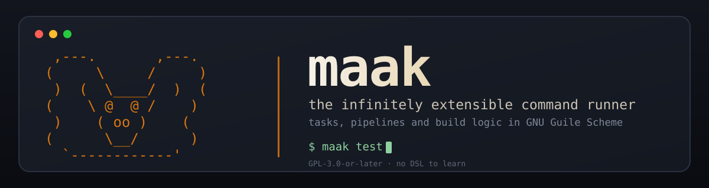

#+title: maak — the infinitely extensible command runner
#+author: Josep Bigorra
#+email: jjbigorra@gmail.com
#+options: toc:nil num:nil

#+attr_html: :width 100% :alt maak — the infinitely extensible command runner

[[https://jointhefreeworld.org/ggg/dist/scheme-guile.svg]]  [[https://jointhefreeworld.org/ggg/dist/gnu-guix.svg]]  [[https://jointhefreeworld.org/ggg/dist/maak.svg]]  [[https://jointhefreeworld.org/ggg/dist/license-gpl3+.svg]]  [[https://jointhefreeworld.org/ggg/dist/license-fdl13+.svg]]
[[https://jointhefreeworld.org/ggg/dist/jointhefreeworld-org.svg]]

*Write your tasks, pipelines and build logic as ordinary Scheme. No DSL to learn, no hidden magic, no leftover build step you cannot read.*

#+begin_quote
Most build tools invent their own limited domain-specific language.  Maak embraces the powerful *λ Lisp* and the amazing Guile Scheme programming language.

/This also means your code is flexible, robust and reliable (+declarative) for at least the next 50 years./
#+end_quote

* What is maak, in fifteen seconds

- *What it is.* A command runner and control plane. You write a file called ~maak.scm~ — a perfectly normal Guile module — and every function in it becomes a runnable task.
- *Who it is for.* Lispers who want their automation to be as powerful as their editor, and everyone who is tired of Make's runes, shell-script glue, and YAML pipelines that cannot loop.
- *Why it matters.* Tasks are real Scheme functions: composable, testable, declarative, dry-runnable, parallelisable, and reproducible.

#+begin_src scheme
(define-module (maak)
  #:declarative? #t
  #:use-module (maak maak))

(define (hello)
  "Say hello from Maak!"
  (log-info "Hello from Maak!"))
#+end_src

#+begin_src shell
maak hello
#+end_src

That is the whole idea. Everything below is what you get once you take it seriously.

#+toc: headlines 1

* Features

- *The entire language, not a DSL* — define functions, use lists and hash tables, write macros, import libraries. If you can write it in Guile, you can write it in a task.
- *A real command line, Make-compatible where it counts* — ~-f~, ~-C~, ~-n~, ~-k~, ~-i~, ~-j~, ~--list~ and friends behave the way your fingers expect.
- *Shell-free by default* — ~run~ takes a program and its arguments as separate strings, so a path with a space in it stays one argument.
- *Real pipelines* — ~run-pipeline~ connects argv stages with ~pipe~ and ~dup2~, reports *every* failing stage instead of just the last one, gives a stage its own environment or ~sudo~, keeps what each stage wrote with ~#:tee~ or ~#:capture?~ so a task can read it, and can run the whole pipeline as a background job.
- *Background jobs with a pid* — ~#:async?~ forks a process and hands back a job record you can poll, wait on, and read the exit code of.
- *Parallel tasks with readable output* — ~maak -j 4 -- fmt,lint,test~ runs tasks in forked workers and prints each one's output as a single block, in the order you named them.
- *Dry-run and quiet as lexical parameters* — ~(parameterize ((dry-run? #t)) …)~ makes destructive code safe to exercise inside a test, without a command-line flag.
- *Environment files and load paths* — ~.env~ files, ~-e~, ~MAAK_ENV_FILE~, ~-L~, ~MAAK_LOAD_PATH~, and ~with-load-path~ for Maak files that are a thin front end over your own modules.
- *Guix and Nix, first class* — ~manifest-shell~, ~program-shell~, time-machine variants, ~guix-container~, ~guix-pack~, mirror-image Nix helpers, and ~guix-build~ / ~guix-program~, which read a pinned Guix as *values* instead of running another Guix.
- *Translation tooling* — the whole GNU gettext workflow (~i18n-extract~, ~i18n-merge~, ~i18n-compile~, ~i18n-refresh~) packaged so you do not rewrite it per project.
- *Errors that read like sentences* — ~task-error~ prints one line and a hint, exits non-zero, and keeps the backtrace behind ~--debug~.
- *Self-documenting tasks* — a docstring becomes the entry in ~maak --list~, laid out so long descriptions stay readable.
- *Shell completions* — Bash, Zsh and Fish, reading your Maak file so TAB knows your tasks.
- *A REPL workflow* — tasks are ordinary definitions, so you can develop them live from Emacs (AREI/Ares), your terminal, or whatever speaks nREPL.

* Installing

** Requirements

- *GNU Guile 3.0 or newer* — maak is written in Guile Scheme and runs wherever Guile 3.0 runs.
- *~bash~, ~coreutils~ and ~util-linux~* — for the ~scripts/maak~ launcher
- *Tested on GNU/Linux but works anywhere Guile works* — the library itself is portable Scheme, but GNU/Linux is where it is built, packaged and exercised.
- *Optional:* [[https://guix.gnu.org/][GNU Guix]] for reproducible environments (heartily recommended), or [[https://nixos.org/][Nix]] if that is your house.

** On Guix (recommended)

maak is Guix-first: the repository ships ~guix.scm~ (the package), ~manifest.scm~ (the development environment) and ~channels.scm~ (the pinned Guix revision), so you can install or try it without leaving the functional world.

Install the current checkout into your profile:

#+begin_src shell
guix install -f ./guix.scm
#+end_src

Enter an environment with maak available, pinned to the channels this project was tested with:

#+begin_src shell
guix time-machine --channels=channels.scm -- shell -f guix.scm
#+end_src

Chain a command to it:

#+begin_src shell
guix time-machine --channels=channels.scm -- \
     shell -f guix.scm -- \
     maak --help
#+end_src

Or use the development manifest, which is how this repository itself runs its tasks:

#+begin_src shell
guix time-machine --channels=channels.scm -- \
     shell -m manifest.scm -- \
     guile -L ./src -c '((@(maak main) main))' --list
#+end_src

maak is also available *upstream in Guix* as ~maak~, in ~(gnu packages build-tools)~:

#+begin_src shell
guix install maak
#+end_src

Upstream currently carries an older release than this checkout; ~guix install -f ./guix.scm~ builds the tree in front of you.

** On Nix

The repository ships both a legacy ~default.nix~ and a flake:

#+begin_src shell
# Building via legacy Nix
nix-build default.nix

# Testing the result
./result/bin/maak --help

# Building via Nix Flakes
nix build
./result/bin/maak --list
#+end_src

** In a container (Podman / Docker)

Prebuilt images live on Docker Hub:

https://hub.docker.com/repository/docker/jjba23/maak/general

You can also build one yourself with ~guix pack~ — see the ~package-docker~ task in ~maak.scm~ — and load the tarball with ~podman load < my.tar.gz~.

Run maak from the container, binding your filesystem so your Maak file is visible:

#+begin_src shell
docker container run -v /home/joe:/home/joe \
    docker.io/jjba23/maak:latest \
    maak -f /home/joe/hacking/maak/maak.scm --list
#+end_src

** openSUSE and other RPM distributions

~maak~ is packaged on OBS: https://build.opensuse.org/package/show/devel:tools:building/maak — download it there, or add the Zypper repository.

To build the RPM locally on Tumbleweed, install the packaging tools and set up the developer directories (see also the ~rpm-build~ task):

#+begin_src shell
sudo zypper install rpm-build rpmdevtools osc rpmlint
rpmdev-setuptree
#+end_src

Create the source tarball with ~git archive~ (or by copying the directory and running ~tar -cvzf~) and place it in =~/rpmbuild/SOURCES/=, then build:

#+begin_src shell
cp packaging/opensuse/maak.spec ~/rpmbuild/SPECS/
rpmbuild -ba ~/rpmbuild/SPECS/maak.spec
#+end_src

You should end up with:

#+begin_src shell
~/rpmbuild/RPMS/x86_64/maak-0.9.0-0.x86_64.rpm
~/rpmbuild/SRPMS/maak-0.9.0-0.src.rpm
#+end_src

Install and run it:

#+begin_src shell
sudo zypper install ~/rpmbuild/RPMS/x86_64/maak-0.9.0-0.x86_64.rpm
maak --help
#+end_src

** Debian and Ubuntu (experimental) 🧪

Install the build tools and compile the package (see also the ~deb-build~ task):

#+begin_src shell
sudo apt update
sudo apt install build-essential debhelper devscripts cme lintian guile-3.0-dev

# Unsigned binary build; copy packaging/debian/* to the root of the repo first
debuild -b -uc -us
#+end_src

** Arch Linux 🧪

TODO 🚧 — patches welcome, see [[*Contributing][Contributing]].

** Check the installation

#+begin_src shell
maak --version
#+end_src

#+begin_src
maak 0.9.0
License: GPL-3.0-or-later
Homepage: https://codeberg.org/jjba23/maak
#+end_src

* Quick start: your first Maak file

** 1. Create ~maak.scm~

In the root of your project, create a file named ~maak.scm~. The module must be named ~(maak)~, and importing ~(maak maak)~ is what puts ~run~, ~log-info~, ~task-error~ and the rest of the toolkit in scope:

#+begin_src scheme
(define-module (maak)
  #:declarative? #t
  #:use-module (maak maak))
#+end_src

** 2. Add a task

Any function with or without arguments is a task:

#+begin_src scheme
(define (hello)
  "Say hello from Maak!"
  (log-info "Hello from Maak!"))
#+end_src

** 3. Run it

#+begin_src shell
maak hello
#+end_src

** 4. Give it arguments

Arguments arrive as strings, because they come from a command line. Convert them explicitly:

#+begin_src scheme
(define (quick-math x-arg y-arg)
  "Add two numbers given on the command line."
  (let ((x (string->number x-arg))
        (y (string->number y-arg)))
    (format #t "~a + ~a = ~a\n" x y (+ x y))))
#+end_src

#+begin_src shell
maak quick-math 23 42
#+end_src

** 5. See what there is

~maak --list~ prints every task, with its docstring as documentation:

#+begin_src shell
maak --list
#+end_src

** 6. Define a default

With no task named, maak runs ~default~:

#+begin_src scheme
(define (default)
  "With no task named, list what there is."
  (list-tasks))
#+end_src

** 7. Do something real

Tasks build command lines out of ordinary strings. Here ~build~ makes a directory and shells out, and ~publish~ refuses politely when there is nothing to ship:

#+begin_src scheme
(define (build)
  "Build the project into ./build."
  (mkdir-p "build")
  (run (list "guix" "build" "-f" "guix.scm")))

(define (publish)
  "Copy the built site to the server."
  (unless (file-exists? "build/index.html")
    (task-error "nothing to publish"
                #:hint "Run `maak build' first."))
  (run (list "rsync" "-av" "build/" "server:/srv/www")))
#+end_src

** 8. Look before you leap

~-n~ / ~--dry-run~ prints the commands instead of running them, and ~-q~ / ~--quiet~ strips the decoration:

#+begin_src shell
maak -n build
#+end_src

#+begin_src
[DRY-RUN]: mkdir -pv build
[DRY-RUN]: guix build -f guix.scm
#+end_src

You now know ninety percent of maak. The rest of this document is the other ten percent, and it is where the fun lives.

* How tasks work

** Any function is a task

Every function you define in the Maak file becomes a runnable task, with or without arguments. There is no registration step and no table to keep in sync.

Tasks can:

- Run shell commands with ~run~, ~$~ and ~run-pipeline~.
- Print logs with ~log-info~, ~log-error~ and ~log-separator~.
- Call other maak tasks as plain function calls.
- Use any Guile function you define, or import from a library.
- Reach for the Guix helpers such as ~manifest-shell~, ~program-shell~, ~time-machine-manifest-shell~ and friends.

You extend maak the same way you extend any Scheme program: by writing more Scheme.

** Exports decide what is runnable

- *Open fallback (no exports).* If you do not write an ~#:export~ directive in your module, or leave it empty, maak is "open season": every procedure in the file is a task.
- *Strict lock (with exports).* If you export anything — say ~#:export (quick-math)~ — then only the exported procedures are tasks. Everything else becomes a private helper, hidden from the CLI and from ~--list~.

That second rule is the quiet superpower: export four tasks, keep forty helpers, and your command line stays a menu rather than a dump.

#+begin_src scheme
(define-module (maak)
  #:declarative? #t
  #:use-module (maak maak)
  #:export (build test deploy))

(define (build)
  "Build everything."
  (run (list "make" "all")))

(define (test)
  "Run the tests."
  (run (list "make" "check")))

(define (deploy)
  "Ship the tarball that `maak build' produced."
  (run (list "scp" (artefact "app") "server:/srv/releases")))

;; Not exported: a helper, invisible to `maak --list'
(define (artefact name)
  (string-append "build/" name ".tar.gz"))
#+end_src

** The default task

If no task is named on the command line, maak runs ~default~. If there is no ~default~, you get a clear error rather than silence.

#+begin_src scheme
(define (default)
  "The task `maak' runs with no arguments."
  (list-tasks))
#+end_src

** Arguments are strings

Task arguments always arrive as strings, because that is what a command line is. Convert them where they enter the task:

#+begin_src scheme
(define (scale factor)
  "Multiply every number in ./data by FACTOR."
  (let ((factor (string->number factor)))
    (for-each (lambda (line)
                (log-info "~a" (* factor (string->number line))))
              (string-lines (read-file "data/numbers.txt")))))
#+end_src

** Do not shadow the built-ins

Avoid task names that collide with names maak or Guile already provide — ~format~, ~display~, ~run~, ~test~ is fine but ~list~ is asking for trouble. Pick something specific: ~fmt~, ~lint~, ~check~, ~ship~.

** Tasks calling tasks

A task is a procedure, so calling one is a function call. No subprocess, no shell, no new interpreter:

#+begin_src scheme
(define (ci)
  "Everything CI does, in order."
  (fmt)
  (lint)
  (test))
#+end_src

When you *do* want a separate process — a clean environment, a different working directory, an exit status of its own — use ~run~ or ~$~.

* The command line

** Options

| Short | Long                   | Argument | Description                                                                    |
|-------+------------------------+----------+--------------------------------------------------------------------------------|
| ~-f~  | ~--file~               | ~FILE~   | Maak file to load (defaults to ~./maak.scm~).                                   |
| ~-C~  | ~--directory~          | ~DIR~    | Change to ~DIR~ before the Maak file is read (repeatable; ~:~-separated allowed). |
| ~-e~  | ~--env-file~           | ~FILE~   | Read ~NAME=VALUE~ assignments from ~FILE~ (repeatable; ~:~-separated allowed).   |
|       | ~--no-env-file~        | None     | Read no environment file at all, whatever the environment says.                |
| ~-h~  | ~--help~               | None     | Display the help screen and exit.                                              |
| ~-i~  | ~--ignore-errors~      | None     | Keep going after a failure, and let the run succeed anyway.                    |
| ~-j~  | ~--jobs~               | ~N~      | Run up to ~N~ tasks at the same time, keeping each task's output together.       |
| ~-k~  | ~--keep-going~         | None     | A task that fails does not stop the tasks after it.                            |
| ~-l~  | ~--list~               | None     | List every available task in the loaded Maak file.                             |
| ~-t~  | ~--tasks~              | ~LIST~   | Run the tasks in ~LIST~ (comma separated), leaving every other word as an argument. |
| ~-L~  | ~--load-path~          | ~DIR~    | Add ~DIR~ to Guile's load path (repeatable; ~:~-separated allowed).              |
| ~-n~  | ~--dry-run~            | None     | Print shell commands instead of executing them.                                |
|       | ~--no-print-directory~ | None     | Do not report the directories ~-C~ changes to.                                  |
| ~-q~  | ~--quiet~              | None     | Quiet mode: no logging, banner or headers.                                     |
| ~-v~  | ~--version~            | None     | Display the maak version and exit.                                             |
|       | ~--banner~             | None     | Print the greeting banner (the default; overrides ~MAAK_NO_BANNER~).            |
|       | ~--no-banner~          | None     | Skip the greeting banner, keeping everything else.                             |
|       | ~--debug~              | None     | Print the Guile backtrace on error (same as ~MAAK_DEBUG=1~).                     |

A manual page is installed with the program, so ~man maak~ shows the same options without leaving the terminal. In a checkout, ~maak man~ previews ~man/maak.1~.

The greeting banner is printed by default. ~--no-banner~ keeps a run's output free of decoration, which is what a script wants, and ~MAAK_NO_BANNER=1~ does the same from the environment. ~--banner~ turns it back on, which is handy when the variable lives in a shell profile.

** Naming tasks and passing arguments

A run names the tasks it is to run, and the words that follow a task are passed to it as its arguments. A double-dash decides what the words around it are:

#+begin_src shell
# One task, given the arguments it takes
maak quick-math 23 42

# The same run, with -- setting the arguments apart.  This is how an argument
# that begins with a dash gets through, unread as an option of maak's own
maak quick-math -- -23 42

# Two tasks, as one comma separated word, dry-run and quiet
maak -n -q clean,build

# The same two tasks, one word each: a -- before the first task word begins the
# task list, and every word up to a further -- names a task
maak -n -q -- clean build

# Tasks named one word each, given arguments of their own after that further --
maak -- clean build -- -v
#+end_src

A ~--~ *after* a task word does not change which words are tasks: everything that follows the first task word is an argument, whether or not it is set apart. So ~maak deploy production~ and ~maak deploy -- production~ are the same run — the task ~deploy~, given the word ~production~ — while ~maak -- deploy production~ names two tasks, ~deploy~ and ~production~. Name the tasks with ~-t LIST~ / ~--tasks LIST~ instead, and every other word of the line is an argument.

That is the whole of the grammar, and the two spellings are the only two: a word never names a task and an argument at once, and a word that happens to name a task is still an argument when it is not the task list or one of the words a ~--~ introduces.

When that is what happened, the run says so. A task handed a word it cannot take fails with Guile's complaint about arity, and when one of those words names a task of the same Maak file the failure carries a hint naming both spellings of the run that was probably meant:

#+begin_src shell
$ maak alpha beta
maak: error: Wrong number of arguments to #<procedure alpha ()>
        hint: `beta' names a task of this Maak file, so alpha received it as an argument.  To run several tasks, name them in one comma separated list (`maak alpha,beta') or one word each after `--' (`maak -- alpha beta'); a task's arguments are the words that follow its name.
#+end_src

** Running several tasks, and from another directory

Four of maak's switches are Make's, because the situations they answer come up in any project and not only in a build:

- ~-j~ / ~--jobs N~ runs up to N tasks at the same time. Each task gets a worker of its own, and its standard output and standard error are printed as one block, in the order the tasks were named, so a parallel run stays readable. A task that fails stops nothing — every named task has already been started, so ~-j~ has ~--keep-going~ for free — and the run fails at the end with the tasks that did not succeed. A task that changes the environment or the working directory changes its worker's copy, not its neighbours'.
- ~-k~ / ~--keep-going~ keeps going after a task fails. Every failure is reported where it happened, naming the task that raised it, and the run fails at the end with the list of tasks that did not succeed. Without it the first failure ends the run, which is what a pipeline of tasks usually wants.
- ~-i~ / ~--ignore-errors~ is the same run with a different verdict: the failures are warnings and the run still succeeds. It is what exercises the rest of a pipeline while one step is known to be broken.
- ~-C~ / ~--directory~ changes directory before anything else — before the Maak file is found, before a ~.env~ beside it is read, and before any task runs — and says which directory it entered.

#+begin_src shell
# Run every task of the pipeline, and see all of the failures at once
maak -k -- fmt,lint,test

# Run the independent ones four at a time, each task's output kept in one block
maak -j 4 -- fmt,lint,test

# Run the tasks of another checkout's Maak file
maak -C ../other-project -- build
#+end_src

~-C~ may be repeated, and the directories are entered in the order given, so ~maak -C build -C signatures -- sign~ runs from ~build/signatures~. A directory that is not there is an error rather than a quiet fallback, because a task must never run somewhere it was not asked to.

The directory a run enters is reported, which is what Make's ~-w~ prints; ~--no-print-directory~ is the switch that leaves those lines out, for a run whose output is read by something other than a person. ~-q~ asks for that silence too, along with the rest of what the run would say.

* Environment files

Settings and credentials often live in a file rather than in the environment. maak reads one before it loads the Maak file, so the names are already in place for every task:

1. ~-e FILE~ / ~--env-file FILE~ names a file. Repeat the flag, or separate several files with ~:~, to read more than one:
   #+begin_src shell
   maak -e .env -e .env.local -- deploy
   #+end_src
2. ~MAAK_ENV_FILE~ is read when no flag is given, with the same ~:~-separated shape:
   #+begin_src shell
   MAAK_ENV_FILE=".env:.env.local" maak deploy
   #+end_src
3. failing both, the ~.env~ file beside the Maak file is read when it exists.
4. ~--no-env-file~ reads none of them.

The file is a list of ~NAME=VALUE~ lines:

#+begin_src shell
# Comments and blank lines are skipped, and a line without a = is ignored.
DATABASE_URL=postgres://localhost/dev
QUOTED="a value with spaces"
SINGLE='single quoted'
#+end_src

Surrounding quotes are removed, so ~QUOTED~ above holds ~a value with spaces~, and the rest of the line is taken as it stands: a value keeps its ~=~, its ~#~ and its inner spaces.

A name the environment already has wins, so a file can hold a sensible default and a one-off ~DATABASE_URL=... maak deploy~ can still point a single run somewhere else. Every file that is read is reported, so a run says where its values came from.

From Scheme, ~load-env-file~ reads one itself and returns the names it set (~#:override? #t~ when the file should win over the environment), and ~env-file-entries~ reads one without touching the environment at all.

* Load paths: requiring your own modules

A Maak file can be a thin front end over modules that live beside it. maak puts the directory of the Maak file itself on Guile's load path, and lets you add more from three angles:

1. the ~-L~ / ~--load-path~ flag, repeatable or ~:~-separated:
   #+begin_src shell
   maak -L ./lib -L ./src -- build
   #+end_src
2. the ~MAAK_LOAD_PATH~ environment variable, a ~:~-separated list:
   #+begin_src shell
   MAAK_LOAD_PATH="./lib:./src" maak build
   #+end_src
3. from Scheme, inside a task or at the top of the Maak file:
   #+begin_src scheme
   (add-load-path! "./lib")            ;; for the rest of the run
   (with-load-path '("./lib" "./src")  ;; only for the thunk
     (lambda () (use-modules (mylib util))))
   #+end_src

All three feed Guile's own ~%load-path~, so they compose with whatever ~GUILE_LOAD_PATH~ is already set. ~with-load-path~ restores the path even when the thunk raises.

One trap worth knowing: whether it is on the load path or not, a ~use-modules~ written *inside a task body* has no effect — it is expanded where it stands, not when the task runs. Import at the top level of the Maak file, as above, or load a module by name from inside a task:

#+begin_src scheme
(define (report)
  (with-load-path '("./lib")
    (lambda ()
      (let ((util (resolve-module '(mylib util))))
        (log-info "~a\n" ((module-ref util 'format-row) '(1 2 3)))))))
#+end_src

* How ~--list~ lays out docstrings

The docstring of a task is its documentation. ~maak --list~ prints it in a way that stays readable no matter how long it is:

- one line prints inline after the name:

  #+begin_src
  build: Compile the project.
  #+end_src

- two lines start inline and align the continuation under the documentation:

  #+begin_src
  build: Compile the project.
         The result lands in ./target.
  #+end_src

- three or more lines become a block, with the name on its own line and every line of documentation indented to the same column:

  #+begin_src
  release:
           Bump the version, tag the tree,
           upload the artefacts and then
           push the tag.
  #+end_src

Common source indentation is removed first, so a docstring written inside an indented procedure still reads flush left.

* Builtins

Every helper below is exported by ~(maak maak)~ and can be called from a task. They all honour the ~dry-run?~ and ~quiet?~ parameters.

** Shell

Two runners sit at the bottom. ~run~ takes a program and its arguments as separate strings and starts it without a shell; ~$~ takes one shell line for the cases that need one. Prefer ~run~: a path with a space in it stays one argument instead of becoming three words.

- ~(run argv)~ — run a program from a list of strings. The first string is the program, every other one is an argument exactly as written.

  #+begin_src scheme
  (run (list "mkdir" "-p" build-dir))
  (run (list "git" "commit" "-m" message))
  (run (list "npm" "ci") #:dev-null? #t)
  (run (list "guix" "shell" "-m" "manifest.scm" "--" "make" "test")
       #:env '("CI=1"))

  (unless (run (list "git" "diff" "--quiet") #:allow-failure? #t)
    (log-info "the tree is dirty\n"))
  #+end_src

  It accepts the same ~#:env~, ~#:sudo?~, ~#:dev-null?~ and ~#:allow-failure?~ keywords as ~$~, and a program that cannot be started exits 127, which is reported like any other non-zero exit. The helpers below (~mkdir-p~, ~cp~, ~mv~, ~cat~, ~touch~, ~ln-s~, ~chmod-file~ and ~delete-file-recursively~) are built on ~run~, so a path with a space in it reaches the program as one argument.

  ~#:expand? #t~ joins the arguments with spaces and hands them to the shell, so a wildcard, ~$VAR~ or a leading tilde is expanded the way a shell would. It is opt-in because the shell then sees words rather than arguments: a path with a space in it becomes several words again. The file helpers pass the keyword through, so ~(delete-file-recursively "build/*.o" #:expand? #t)~ removes every object file the shell names.

- ~(run-pipeline stages)~ — run programs one after another with each standard output feeding the next standard input, without a shell:  #+begin_src scheme
  (run-pipeline (list (list "cat" file)
                      (list "grep" "-v" "^#")
                      (list "sort" "-u")))

  ;; a stage with options of its own, in a pipeline with an environment
  (run-pipeline (list (stage (list "sort" "-u") #:env '("LC_ALL=C"))
                      (stage (list "tee" log)   #:sudo? #t))
                #:env '("SOURCE=ci"))

  ;; keep what each stage wrote, and read it back in the task
  (define result
    (run-pipeline (list (list "git" "diff" "--cached")
                        (list "grep" "^+"))
                  #:capture? #t #:allow-failure? #t))
  (pipeline-outputs result)   ;; one string per stage, in order
  (pipeline-ok? result)       ;; #f when a stage failed
  #+end_src

  Each stage is an argument list shaped like ~run~'s, or a ~stage~ form, which
  adds the options ~run~ takes for that stage alone: ~#:env~, ~#:sudo?~ and
  ~#:tee~. A stage's environment is added to the pipeline's own, later names
  winning, and the command line is built the way ~run~ builds one
  (~sudo env A=1 …~), which is what gets an assignment to the program when the
  shell that usually reads it is not there.

  The pipeline itself takes ~#:env~ for all of its stages, ~#:verbose?~ and
  ~#:allow-failure?~. Unlike a shell's ~|~, which reports only the last stage,
  a pipeline reports every stage that failed; ~#:allow-failure? #t~ returns ~#f~
  instead of raising. ~#:async? #t~ starts the *pipeline* in the background and
  returns a job, whose exit code is 0 only when every stage succeeded -- a stage
  is not a job of its own, because it cannot finish before the stage after it
  has read what it wrote.

  A pipeline's output can be looked at afterwards in two ways. ~#:tee FILE~ on
  a stage keeps a copy of that stage's standard output, while the stage after
  it reads the same bytes as they are produced, so nothing is held back until
  the pipeline ends; a ~#:tee~ on the last stage still prints, as ~tee~ does.
  ~#:capture? #t~ records every stage's standard output that way, in temporary
  files it removes afterwards, and returns a ~<pipeline-result>~ instead of
  printing: the last stage's output is the last entry of ~pipeline-outputs~,
  ~pipeline-ok?~ answers whether every stage succeeded, and ~pipeline-errors~
  names the ones that did not. That is what lets a task decide from what a
  pipeline produced -- the number of changed lines, the files a ~grep~ matched
  -- without running it twice. Capturing and ~#:async?~ are refused together,
  because the background process would be the one holding the bytes; use
  ~#:tee~ and read the file.

- ~(run argv #:async? #t)~ — start the program in the background and return a *job* record. Unlike a trailing ~&~, the job has a pid and a status that can be waited for:

  #+begin_src scheme
  (define server (run (list "guix" "shell" "--" "run-server") #:async? #t))
  (log-info "server started as ~a\n" (job-pid server))
  ...
  (unless (wait-job server)
    (task-error "the server exited with a failure"))
  #+end_src

  ~job?~, ~job-pid~, ~job-command~, ~job-done?~ (non-blocking), ~wait-job~ (returns ~#t~ when the exit code is 0) and ~job-exit-code~ read the job. ~$~ and ~syscall~ return the same record for ~#:async?~, so a background shell line can be waited on too; maak forks the process rather than leaving a ~&~ to the shell, which is what makes the pid available.

- ~($ parts ...)~ — run a shell command built from strings, joined by spaces. This is the escape hatch, for pipes, redirections, globs, ~$(...)~ and ~VAR=value~ prefixes. The command can be decorated with keyword arguments, applied in the order a shell would write them: ~[sudo] [env A=1] COMMAND [>/dev/null 2>&1]~.

  #+begin_src scheme
  ($ '("systemctl daemon-reload") #:sudo? #t)
  ($ '("make" "-j4") #:env '("CI=1" "V=1"))     ;; env CI=1 V=1 make -j4
  ($ '("npm ci") #:dev-null? #t)                   ;; npm ci >/dev/null 2>&1
  (define watch ($ '("tsc --watch") #:async? #t))   ;; a job, see wait-job

  (unless ($ '("git diff --quiet") #:allow-failure? #t)
    (log-info "the tree is dirty\n"))
  #+end_src

  ~#:env~ takes an alist (~(("CI" . "1"))~), a list of ~KEY=VALUE~ strings or one such string, and the names are set for that command alone. They go through ~env~ rather than as a ~KEY=VALUE~ prefix, which is what lets them reach a command running inside a ~guix shell~.

  ~#:allow-failure?~ returns ~#f~ instead of raising when the command exits non-zero, so the task is told the command failed and can decide what that means; it is the ~cmd || true~ idiom, except that the failure is not hidden from the task. ~#:async?~ starts the command in the background and returns a job, and ~#:sudo?~ runs it as root — both are printed by ~--dry-run~ like anything else, so they can be checked before they are really run.

- ~syscall~ — run one shell line and raise when it exits non-zero; it is ~$~ without the list of parts.
- ~capture~ — return a command's output. A command that exits non-zero raises an error naming its exit code instead of returning the empty or partial output it produced; pass ~#:allow-failure? #t~ to read that output anyway.
- ~which~, ~command-exists?~, ~require-command~ — find a program on ~PATH~.
- ~shell-quote~ — quote a value so a shell reads it as one word.
- ~read-file~, ~write-file~ — read and write a file from Scheme.
- ~mkdir-p~, ~remkdir-p~, ~delete-file-recursively~, ~cp~, ~mv~, ~cat~, ~touch~, ~ln-s~, ~chmod-file~ — file helpers, all built on ~run~.
- ~with-directory~, ~cd~, ~env-get~, ~env-set!~, ~env-unset!~, ~with-env~, ~with-env-vars~, ~home-dir~, ~tmp-dir~, ~load-env-file~, ~env-file-entries~.
- ~list-tasks~, ~available-task-names~, ~run-task~, ~run-tasks~ — the task registry, for tasks that run other tasks or print the menu.

** Reporting a failure from a task

A task that fails should read like maak's own errors: one line saying what went wrong, and a hint saying what to do about it. ~task-error~ is that, with an optional format string and its arguments:

#+begin_src scheme
(define (deploy)
  "Deploy the artefact built earlier."
  (task-error "no artefact for ~a" #:args (list "linux-x86_64")
              #:hint "Run `maak build' first."))
#+end_src

~maak deploy~ then prints

#+begin_src
maak: error: no artefact for linux-x86_64
        hint: Run `maak build' first.
#+end_src

and exits non-zero without a backtrace, so a user reads a sentence instead of a trace. ~--debug~ (or ~MAAK_DEBUG=1~) brings the backtrace back when the failure is the program's own fault rather than the project's. ~raise-maak-error~ is the same mechanism for a message that is already formatted, and ~maak-error?~ recognises either one.

** Pretty multiline strings

Guile has no heredoc, so a long message is a string spanning several source lines with the source indentation baked in. These helpers take it back out:

#+begin_src scheme
(text "first line"
      "second line")        ;; => "first line\nsecond line"
(dedent-string indented)      ;; remove the common indentation
(indent-string s #:by 4)      ;; add indentation
(unlines '("a" "b"))          ;; join with newlines
#+end_src

** Guix

The helpers come in two families. The first builds command lines — the
environment, the container, the pack — and the second asks Guix for values, so
a task can decide on what a pin actually contains.

- ~manifest-shell~, ~program-shell~ and their ~time-machine-~ variants.
- ~time-machine~ — any command, run by a Guix pinned to ~channels.scm~.
- ~guix-shell~ — a shell described by a package list.
- ~guix-container~ — ~guix shell --container~, optionally with ~--network~, ~-S~ shares and ~-E~ exposures.
- ~guix-pack~ — build a ~guix pack~ (docker, squashfs, tarball).
- ~guix-available?~ — whether a ~guix~ program is on ~PATH~.
- ~guix-channels~ — the pins ~channels.scm~ names, as a ~(name . commit)~ alist.
- ~guix-derivation~ — the derivation of a package at those pins; nothing is built.
- ~guix-build~ — the same, built, answered with its store directory.
- ~guix-program~ — run a program out of that directory, with the decorations ~run~ takes.
- ~guix-derivation-at~, ~guix-build-at~, ~guix-program-at~ — the same against one Guix revision, without a ~channels.scm~ and without ~guix time-machine~.

The command-line helpers take the same ~#:env~, ~#:sudo?~, ~#:dev-null?~,
~#:allow-failure?~ and ~#:async?~ keywords as ~$~, and pass them to the command
they build. The value helpers return Scheme data instead:

#+begin_src scheme
(define (report-pin)
  "Show what channels.scm pins hello to, then run that hello."
  (log-info "pinned: ~a\n" (cdr (assoc "guix" (guix-channels))))
  (log-info "hello at that pin: ~a\n" (guix-build "hello"))
  (guix-program "hello" '("--version"))

  ;; one old tool, for one step, without touching the project's channels
  (guix-program-at "0fb918d61609f3aadc2d8ecc212926b3bdfabb4c"
                   "hello" '("--version")))
#+end_src

~guix-build~ hands back the store path rather than printing it,
~guix-derivation~ stops one step earlier and names the recipe,
~guix-program~ runs the binary that pin produced instead of whatever the
machine has installed, and ~guix-channels~ reads the pins into a list a task
can compare against. A package the pin does not have is a sentence about the
name, not a Guix backtrace: ~no package named foo in that Guix revision~, with
a hint. ~#:system~ selects a target system for a cross build, and
~guix-program~ takes ~#:program~ when the binary is not named after the
package (~~(guix-program "coreutils" '("-l" "/gnu/store") #:program "ls")~~).

The dependency is loose on purpose. Nothing in maak imports a ~(guix ...)~
module: the asking happens in ~guix repl~, Guix's own Guile, and the answer
comes back as Scheme data. maak therefore builds and runs on a machine with no
Guix at all, and only a task that calls one of these helpers gets a one-line
error with a hint saying so. The price is a process per query — about a third
of a second, plus the store connection — so ask when the answer matters rather
than in a loop; ~cached-channel-instance~ makes the second question about the
same pins cheap, and a channels file that has never been fetched is fetched
here, with the network and the wait that takes. The query file is removed after
it runs, except when Guix refuses to answer: then it is kept and the error
names it, so the program can be run by hand to read what Guix itself said.

** Nix

Mirroring the Guix helpers, for machines that use Nix:

- ~nix-shell~ (classic, ~shell.nix~), ~nix-develop~ (flakes), ~nix-build~, ~nix-flake-build~, ~nix-flake-check~, ~nix-run~.

They take the same decorations as the Guix helpers and as ~$~.

** Internationalisation

The gettext workflow, packaged so it does not have to be rewritten per project. The layout is the conventional one (~DIR/LANG/LC_MESSAGES/DOMAIN.po~):

#+begin_src scheme
(define (i18n)
  "Refresh every translation catalogue."
  (i18n-refresh '(en_US nl_NL es_ES)
                #:dir "po"
                #:textdomain "myproject"
                #:directories '("lib" "app/views")))
#+end_src

- ~i18n-extract~, ~i18n-init~, ~i18n-merge~, ~i18n-compile~ — the four GNU gettext tools.
- ~i18n-init-all~, ~i18n-merge-all~, ~i18n-compile-all~, ~i18n-refresh~ — the same over a list of languages.
- ~i18n-locale-dir~, ~i18n-po-file~, ~i18n-mo-file~, ~i18n-pot-file~, ~i18n-source-globs~ — where the catalogues live.
- ~i18n-translator~, ~i18n-language~ — load a catalogue and get a translate procedure.

* Configuration

maak is configured three ways, in increasing order of precision: command-line flags, environment variables, and Scheme parameters you set lexically inside a task.

** Environment variables

| Variable          | What it does                                                        |
|-------------------+---------------------------------------------------------------------|
| ~MAAK_ENV_FILE~   | Environment file(s) to read, ~:~-separated, when ~-e~ is not given.  |
| ~MAAK_LOAD_PATH~  | Extra Guile load path entries, ~:~-separated.                        |
| ~MAAK_NO_BANNER~  | Set to ~1~ to skip the greeting banner.                             |
| ~MAAK_DEBUG~      | Set to ~1~ to print the Guile backtrace on error.                   |

#+begin_src shell
MAAK_ENV_FILE=".env:.env.local" MAAK_NO_BANNER=1 maak -- build
#+end_src

** Parameters: dry-run, quiet, banner

Dry-run and quietness can be set globally with ~-n~ / ~-q~, but they are also Scheme parameters that can be overridden in lexical scope. That gives you precise control, and it is what makes destructive code safe to exercise in tests:

#+begin_src scheme
(define (fmt)
  "Format Scheme source files according to the Guix style guide."
  (syscall "ls") ;; this will run
  ;; this will not
  (parameterize ((dry-run? #t)
                 (quiet? #f))
    (delete-file-recursively "tmp")
    ($ '("find . -maxdepth 8 -name '*.scm'"
         "-type f -exec guix style -f {} \\;")
       #:verbose? #t)))
;; it will print instead of running
;; [DRY-RUN]: rm -rfv tmp
;; [DRY-RUN]: find . -maxdepth 8 -name '*.scm' -type f -exec guix style -f {} \;
#+end_src

* Coming from Make

maak shares Make's command line wherever the two answer the same question, so a ~make~ habit usually lands:

| ~make~                       | maak                                                              |
|------------------------------+-------------------------------------------------------------------|
| ~-f FILE~                     | ~-f/--file FILE~, and ~./maak.scm~ when it is not given            |
| ~-C DIR~                      | ~-C/--directory DIR~, which also prints the directory it entered   |
| ~-n/--dry-run~                | ~-n/--dry-run~                                                     |
| ~-s/--silent~                 | ~-q/--quiet~ (Make's own ~-q~ asks a different question)            |
| ~-k/--keep-going~             | ~-k/--keep-going~                                                  |
| ~-i/--ignore-errors~          | ~-i/--ignore-errors~                                               |
| ~-I DIR~                      | ~-L/--load-path DIR~                                               |
| ~-h~, ~-v~                    | ~-h/--help~, ~-v/--version~                                        |
| ~-w/--print-directory~        | the default with ~-C~; ~--no-print-directory~ leaves it out         |
| ~-p/--print-data-base~        | ~--list~                                                           |
| ~--debug~                     | ~--debug~ (the Guile backtrace of the error)                       |
| ~-e/--environment-overrides~  | the environment already beats a ~.env~ file; ~-e~ is ~--env-file~ here |
| ~.DEFAULT_GOAL~               | the ~default~ task, and a clear error when there is none            |
| ~.PHONY~                      | nothing: every task runs when it is asked to                        |
| ~MAKEFLAGS~, ~MFLAGS~         | ~MAAK_ENV_FILE~, ~MAAK_LOAD_PATH~, ~MAAK_NO_BANNER~, ~MAAK_DEBUG~   |
| ~$(shell ...)~, ~$(wildcard ...)~ | any Scheme: ~run~, ~capture~, ~$~, ~file-exists?~               |
| ~include other.mk~            | ~use-modules~, or ~load~ from a Maak file                           |

Three families of Make options have no counterpart, and each is a design decision rather than an omission:

- *File targets and timestamps.* Make decides whether to run a recipe by comparing the timestamps of files (~-B~, ~-t~, ~-o~, ~-W~, pattern rules, ~VPATH~, implicit rules). maak has no targets to compare and runs the task it was asked for; a task that wants to skip work says so itself, in Scheme, where the condition can be anything — a hash, a row in a database, a check over the network — and not only the age of a file.
- *Parallel jobs.* maak's ~-j/--jobs N~ runs up to N tasks at once, each in a forked worker whose output is printed as one block in the order the tasks were named; a task that wants to do several things inside itself uses Guile's own concurrency, as the test suite here does with ~VERITAS_JOBS~. Make's jobserver machinery and the refinements of job control (~-l~, ~-S~, ~--output-sync~, ~--trace~) have no counterpart: the block is the output synchronisation, and the number of jobs is the only control.
- *The Makefile language itself.* Variables, ~$(...)~ expansion and the recipe prefixes ~@~, ~-~ and ~+~ have nothing to do here: a Maak file is Scheme, and a task's commands are the strings it builds. ~-r~, ~-R~ and ~--warn-undefined-variables~ exist to tame built-in rules and variables that maak does not have; an unbound variable is already an error with a hint.

* Why maak?

** The trouble with Make

Have you ever found Makefile to be repetitive, lacking expressiveness and having a weird, limited syntax and unexpected arcane behaviour?

Many developers find GNU Make and related tooling frustrating despite its power. Makefiles often contain repetitive code, particularly when dealing with similar targets or file types: you may have to write a separate rule for every output file, even when the process is exactly the same. The limited syntax makes it hard to abstract that logic into reusable functions or macros, which leads to copy-paste.

Make's syntax is a Domain-Specific Language, not a general-purpose programming language. It is powerful for managing dependencies and terrible for anything else. Defining variables, using conditionals, or looping over a list of items is surprisingly clunky and often requires arcane, non-standard constructs. And Make has many gotchas that trip up even experienced users.

** What maak does differently

maak gives you Scheme. You are not restricted to a limited, weird syntax: you can define functions to avoid repetition, create complex data structures, use control flow, and write data-driven builds that would be unthinkable in a Makefile. A loop over your source files replaces a rule per file.

That also means you do not have to learn a new language to automate your project. Your existing Lisp knowledge transfers directly, and the code is easier to read, write and maintain because it is just code.

maak is designed to be your central control plane. While Make focuses on building software from source, maak is a general-purpose command runner: tests, deployments, environment management, release chores, database migrations, documentation, whatever your project needs. It is a more flexible and more powerful alternative for all of your automation.

** The philosophy of maak

- *Lisp as the language of tasks.* Every build rule, every script, is a first-class Scheme function, so your automation is composable, readable and hackable.
- *Purity and reproducibility.* maak believes in deterministic environments, which is why it integrates so well with GNU Guix 🐂.
- *Small is beautiful.* No YAML, HOCON or INI, no hidden logic, no magic — just clean Scheme. Every part of maak can be read, understood and extended within a good afternoon of hacking ☕.
- *Free as in freedom.* maak is free software under the GNU GPL, built to encourage curiosity, learning and contribution. You own your build logic; you can read it, change it and share it freely.

* Who uses maak

Projects that run their automation on maak (and make good reading if you want real Maak files to steal from):

- [[https://codeberg.org/jjba23/heks-linux][Heks GNU/Linux]] — the witches' GNU/Linux: modular, flexible, reproducible, powered by Lisp and Fedora/Debian + GNOME/Niri.
- [[https://codeberg.org/jjba23/lucidplan][LucidPlan]] — project management (CMS) for everyone, free and open.
- [[https://codeberg.org/jjba23/veritas][Veritas]] — unit, integration and black-box testing framework powered by Lisp (Guile Scheme).
- [[https://codeberg.org/jjba23/mutastructura][Mutastructura]] — relational schema and database migrations powered by Lisp.
- [[https://codeberg.org/jjba23/ggg][GGG (Guile Glyph Generator)]] — create SVG images, handy glyphs, org/markdown badges.
- [[https://codeberg.org/jjba23/hygguile][Hygguile]] — a UI framework for cozy, professional user interfaces, with the power of Scheme.
- [[https://codeberg.org/jjba23/sss][SSS (Supreme Sexp System)]] — a Lisp machine adventure where hacking culture is celebrated.

Using maak in your project? Send a link and it can be listed here.

* Editor and shell integration

** Shell completions

maak ships completions for Bash, Zsh and Fish. In a directory with a Maak file, type ~maak~, a space, then TAB, and the task names appear. The completion scripts read the current Maak file and extract task names from it.

The scripts live in ~scripts/~ and, in most situations, are installed for you. If you installed by hand, load them yourself — these variables are handy if you run Guix:

#+begin_export html

  
See a Bash example of manual completion load

#+end_export

#+begin_src shell
#!/usr/bin/env bash
maak_bin_install_dir=$(which maak)
maak_install_dir=$(realpath "${maak_bin_install_dir}")
maak_bin=$(dirname "${maak_install_dir}")
maak_store=$(dirname "${maak_bin}")
maak_completions="${maak_store}/share/bash-completion/completions/maak"

# Load Maak auto-completions
if [[ -f "${maak_completions}" ]]; then
  source "${maak_completions}" || true
fi
#+end_src

#+begin_export html

#+end_export

** Emacs

There is an Emacs integration, [[https://codeberg.org/jjba23/maak.el][maak.el]]:

#+attr_html: :width 640px
[[https://jointhefreeworld.org/static-assets/maak/maak-in-emacs.png]]

maak also plays nicely with the AREI/Ares nREPL server (see the ~repl~ task in this repository), which is how the author drives tasks straight from Emacs.

** The REPL workflow

A REPL is an interactive environment connected to your console, your running application, your compiler — and it gives you superpowers as an engineer 🦸🏼. Lisp dialects, and Guile in particular, have excellent support for this. The author's own setup is [[https://guix.gnu.org/][Guix]], [[https://www.gnu.org/software/emacs/][Emacs]], [[https://git.sr.ht/~abcdw/emacs-arei][Arei/Ares]] and [[https://github.com/vspinu/sesman][sesman]]: an infinitely extensible editor experience, miles ahead of traditional IDEs 🐂.

It fundamentally changes the development workflow by eliminating the slow /edit, save, compile, run/ cycle:

- *Incremental development.* Write, test, inspect and evaluate one function — or one line — at a time, with immediate feedback and no full rebuild.
- *Powerful debugging.* Forget ~print~ statements and restarts: pause, inspect objects, change values, redefine a broken function on the fly, in any environment.
- *Fast prototyping.* Load a library and call its functions to learn it, which is much faster than reading documentation alone.

Integrated into your editor, you can execute any piece of code (a line, a selection, a file) with a keyboard shortcut and see the result instantly.

* This project's own automation

The repository's automation is written in maak itself — read [[file:maak.scm][maak.scm]] for the full source. Run ~maak --list~ (or ~./scripts/maak --list~ from a checkout) to see them with their docstrings.

| Task                                   | What it does                                                     |
|----------------------------------------+------------------------------------------------------------------|
| ~default~                              | List the available tasks.                                        |
| ~help~                                 | Display the program's help screen.                               |
| ~man~                                  | Preview ~man/maak.1~ without installing anything.                |
| ~version~                              | Print the version, license and homepage.                         |
| ~test~                                 | Run the unit test suite with Veritas.                            |
| ~container~                            | Run the same suite inside a networkless Guix container.          |
| ~repl~                                 | Development REPL (Ares nREPL server).                            |
| ~dev~, ~hr~, ~hot-reload~              | Watch the tree and re-list tasks on every change.                |
| ~pure-dev~                             | Pure, isolated development shell.                                |
| ~nix-dev~, ~flake-check~               | Enter the Nix shell; validate the flake's outputs.               |
| ~fmt~                                  | Format Scheme sources with ~guix style~.                         |
| ~docs~                                 | Generate the API documentation.                                  |
| ~deploy~                               | Generate and publish the documentation.                          |
| ~package-docker~                       | Build a Docker image with ~guix pack~.                           |
| ~push-docker-latest~, ~push-docker-tag~ | Push that image to Docker Hub.                                   |
| ~deb-build~, ~rpm-build~               | Build the Debian and RPM packages.                               |
| ~test-playground~                      | Play with temporary files and dry-run scopes.                    |
| ~arithmetics~, ~vars~, ~quick-math~    | Small demonstrations of what a task can be.                      |

* Hacking on maak

In systems where ~maak~ is already installed, a good way to compile from source and test all program functionality is a pure shell:

#+begin_src shell
guix shell --pure -f guix.scm \
     bash coreutils util-linux-with-udev guile -- \
     maak --list

# Run the project tests
guix time-machine --channels=channels.scm -- \
     shell -f guix.scm --pure -- \
     maak test
#+end_src

Before anything is installed, the launcher under ~scripts~ runs this checkout's own sources inside the environment ~manifest.scm~ declares:

#+begin_src shell
guix shell -m manifest.scm -- ./scripts/maak --list
guix shell -m manifest.scm -- ./scripts/maak test
guix shell -m manifest.scm -- ./scripts/maak man
#+end_src

** Tests

The tests live under ~test/veritas/unit~ and are written with [[https://codeberg.org/jjba23/veritas][Veritas]]. ~maak test~ runs them; the same run by hand is:

#+begin_src shell
VERITAS_TEST_MODULE=veritas VERITAS_TEST_TOP_DIR=test \
  VERITAS_TEST_TYPE=unit VERITAS_RUN_BENCHMARKS=false \
  guix shell -m manifest.scm -- \
  guile -L ./src -L ./test -c '((@ (veritas runner) run-tests))'
#+end_src

That has to be *this* checkout's maak, not the one an installed ~maak~ was built with. The Maak file beside it may ask for modules a released library does not have, and the mismatch shows up as ~no code for module (maak ...)~, which reads like a missing file rather than as a version problem. The launcher under ~scripts~ falls back to the sources beside it, so the checkout's own maak is one command away, inside the environment ~manifest.scm~ declares.

Two kinds of spec sit in that directory, and the difference is what each one can see. Most of them call ~main~ in process with the output ports captured, which is how a test asserts on what a user reads while keeping a run cheap. What that cannot show is anything that belongs to the process rather than to the call: the exit status an operating system sees, which of the two streams a line went to, and the argument grammar of ~scripts/maak~ itself, which is what turns a command line into the Guile invocation ~main~ is handed. Those are what ~test/veritas/unit/integration.scm~ is for, running the launcher as a real subprocess. A suite run is the two together; nothing else starts the launcher, and nothing else reads the library the way a caller does.

The fixtures those tests use — a module with exports and one without, a Maak file with failing tasks for the keep-going flags, and a directory holding a Maak file of its own — live under ~test/maak/fixtures~ and are deliberately kept out of the directory the runner scans.

Three things are worth knowing when adding a test, because two of them fail quietly rather than loudly:

- A case has to *evaluate to an assertion*, which is a procedure of one validation client. A bare ~assert-*~ call is one, and so is a ~let~ whose last form is one. A body that ends in ~(delete-file ...)~ is not: the case becomes no case at all, and the test passes without checking anything. Cleanup therefore belongs in a ~#:after~ hook, or in the ~after~ thunk of a ~dynamic-wind~ around the assertion, or before the assertion is built.
- One assertion per case. A case is the value a form evaluates to, so an assertion wrapped in a body of several forms — a ~let~ around five ~assert-*~ calls, say — is evaluated while the file loads and then dropped: only the *last* form of the body is the case that runs and can fail. The four before it still run, but nothing reads their verdict, so they cannot fail the run. Write one assertion per form and give each one the setup it needs; a run of the CLI costs milliseconds, which is cheaper than a test that cannot fail.
- Anything left directly in a ~suite~, outside any ~test~, is treated as a case of the suite, and its result is read as though it were an assertion: the run then dies with "could not read assertion success from unknown type". A parenthesis that closes a ~test~ a line too early is enough to do it.

The first two fail quietly, and nothing catches them for you: the run exits 0 and a test that asserted nothing passes exactly where one that asserts does. The only sign is in the report, which prints the value of every case under the test it belongs to — a test with no line under it ran no case at all, and a case showing one value where two assertions were written means one of them was never read. Read the report, and prefer a test that can fail to a count of tests that passed.

** Documentation

The technical Guile API documentation is generated from the sources with ~maak docs~ and published here:

https://jointhefreeworld.org/api-docs/maak/API.html

The manual page lives in ~man/maak.1~, is installed with the program, and is previewed by ~maak man~. ~maak --help~ and ~resources/help.txt~ carry the same option reference.

* On reproducibility: why GNU Guix?

A build should never fail because "it worked on my machine." Reliable software development requires explicit, bit-for-bit reproducibility and a functional approach to package management and system deployment.

#+BEGIN_EXPORT html

#+END_EXPORT

- *Declarative build graphs.* Packages are pure functions of their inputs, with no implicit system state.
- *Programmable with Guile.* Full system and package configurations in [[https://www.gnu.org/software/guile/][Guile Scheme]] rather than rigid DSLs or static files.
- *Time travel.* Rebuild the exact system state from any point in git history with ~guix time-machine~.
- *Atomic operations.* Upgrade or roll back environments without orphaned dependencies or broken states.
- *Unified tooling.* One tool manages development shells, isolated containers, package builds and full system configurations.

maak inherits all of that for free, because a Maak file is just another Scheme file that Guix can evaluate — and because the same pin in ~channels.scm~ can drive the shell, the tests and the release. The pin is also readable from a task: ~guix-build~ and ~guix-program~ turn it into a store path and a program to run, which is what ~guix time-machine~ would otherwise have to be started for.

* Community and support

Join the ~maak~ community to ask questions, discuss development, share configurations and screenshots, report issues, or just hang out:

- *Issues and development:* [[https://codeberg.org/jjba23/maak][the Codeberg repository]].
- *Chat, support, discussion, announcements:* [[https://jointhefreeworld.zulipchat.com/#narrow/channel/632494-maak][the maak Zulip community]].

If you are unsure where to start, Zulip is recommended. Codeberg issues are also a good place for ideas, bugs and improvements. The backlog and Kanban boards live at https://lucidplan.jointhefreeworld.org/tickets/maak.

If you like this work, you can [[https://bmc.link/jjbigorra][buy me a cup of coffee ☕]] so I can keep going with a lot of motivation.

* Contributing

Contributing to free software is a uniquely beautiful act: it embodies generosity, collaboration and empowerment.

We welcome everyone to the maak project, and encourage contribution in all its forms — code, documentation, translations, bug reports, a well-argued complaint about an error message, or a Maak file from your own project that we can learn from. Feel free to contact the maintainer at <jjbigorra@gmail.com> to chat, discuss or give feedback.

maak embodies the spirit of GNU: simplicity, freedom and curiosity. It is both a tool and a playground for learning Lisp-based automation. As you grow comfortable, extend it — define your own DSLs, orchestrate builds, automate your projects in elegant Scheme.

** Reporting bugs and asking for features

Open an issue on [[https://codeberg.org/jjba23/maak/issues][Codeberg]]. A useful report includes:

- what you ran (the exact command line, including flags),
- what you expected and what happened,
- the maak version (~maak --version~) and how it was installed,
- the smallest Maak file that still shows the problem, if there is one.

** Sending patches

1. Fork the repository and create a topic branch.
2. Make the smallest change that solves the problem, in the style of the surrounding code.
3. Run ~maak fmt~ to format Scheme sources the way the project does.
4. Run the suite: ~guix shell -m manifest.scm -- ./scripts/maak test~. Everything must pass.
5. If you changed behaviour, say so in the commit message *and* in the documentation (README, man page, or docstring — whichever is closest to the change).
6. Open a pull request on Codeberg, or mail a patch to <jjbigorra@gmail.com>.

New tasks in this repository's own ~maak.scm~ always get a docstring, because that docstring is what ~maak --list~ shows to the next person.

** AI policy

This project adheres to the [[https://jointhefreeworld.org/blog/articles/personal/jointhefreeworld-ai-policy/index.html][jointhefreeworld AI (Artificial Intelligence) policy]].

Our core principle is simple: *AI should assist human creativity and problem-solving, never replace human reasoning.*

While tools like Large Language Models (LLMs) and interactive chatbots can be beneficial for reviewing, refactoring small functions, or acting as a sounding board, they should be used with moderation.

We require a human in the loop for all contributions. The use of autonomous AI agents to automatically generate and submit pull requests to this project is strictly prohibited.

** Code of conduct

This project adheres to the jointhefreeworld code of conduct, available here:

https://jointhefreeworld.org/blog/articles/personal/jointhefreeworld-code-of-conduct/index.html

In summary, we foster an inclusive, respectful and cooperative environment for all contributors and users of this free software project. Inspired by the ideals of the GNU Project, we strive to uphold freedom, equality and community as guiding principles. We believe that collaboration in a community of mutual respect is essential to creating excellent free software.

* License

maak and all of its source code are free software, licensed under the *GNU General Public License v3 or newer* (GPL-3.0-or-later), at your convenience.

https://www.gnu.org/licenses/gpl-3.0.html

The documentation and examples, including this document, are licensed under the *GNU Free Documentation License v1.3 or newer* (FDL-1.3-or-later), at your convenience.

https://www.gnu.org/licenses/fdl-1.3.html

In short: use it, study it, change it, share it — and if you ship a modified maak, ship the source too.

* Colophon

- The mascot logo was generated by the ChatGPT Dall-E LLM when fed this very document:

  #+attr_html: :width 320px
  [[https://jointhefreeworld.org/static-assets/maak/new-maak-small.png]]
- The banner at the top of this file is hand-written SVG, living in  — no external assets, no font downloads, so it renders anywhere the file goes.
- The badges come from the [[https://jointhefreeworld.org/][jointhefreeworld]] glyph generator.
- The text-mode logo, for terminals and plain-text readers:

#+begin_src
 ,---.       ,---.
(     \     /     )
 )  (  \____/  )  (
(    \ @  @ /    )      [ Maak ]
 )    ( oo )    (       The infinitely extensible
(      \__/      )      command runner, control plane,
  `------------'        and project automator.
#+end_src

Happy hacking! ✨
